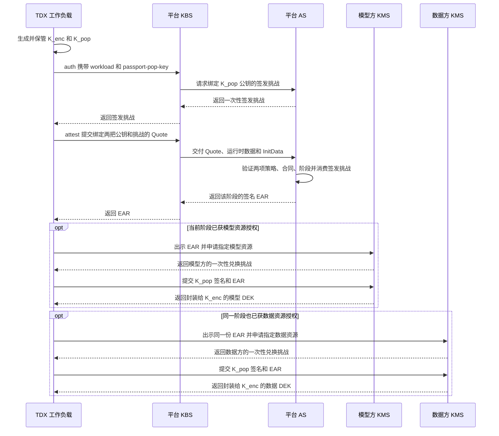

# 模型方与数据方独立 KMS 的护照设计

本设计适用于模型方和数据方分别拥有密文、密钥和业务授权的机密训练或推理任务。工作负载先向平台 AS 提交 TDX Quote 并取得签名 EAR，再向各资产方出示护照。模型方决定是否释放指定模型的 DEK，数据方决定是否释放指定数据的 DEK。平台 AS 负责评估证据，平台 KBS 可以负责转发证明请求。两方 KMS 的密钥保管和资源授权留在各自的信任域。

本文记录 `passport-app-measurement` 上的两种资产取钥流程，以及推理客户端走 KBS 护照时的会话绑定。基础流程按资产方挑战逐次取证，可复用流程允许在同一个获批阶段重用 AS 护照。两种流程都保留资产方的独立授权权力。

## 信任边界

| 参与方 | 本方控制的内容 | 本方验证或输出的内容 |
| --- | --- | --- |
| 模型方 | 模型密文、模型 DEK、审批签名私钥、模型 KMS 的资源授权和挑战 | 独立审核作业合同，验证护照与模型资源授权，用护照绑定的接收公钥包装模型 DEK |
| 数据方 | 数据密文、数据 DEK、审批签名私钥、数据 KMS 的资源授权和挑战 | 独立审核同一份作业合同，验证护照达到获批阶段，用护照绑定的接收公钥包装数据 DEK |
| 用户方 | 作业请求和自身的合同签名私钥 | 与两资产方签署同一份合同，提交合同所批准的工作负载 |
| 平台 KBS、AS 和 RVPS | KBS 的证明入口、AS 的证据校验及签名、RVPS 的参考值 | 验证启动环境、应用度量和阶段，签发包含评估结果与绑定字段的 EAR |
| TDX 工作负载 | 接收密钥私钥、持有证明私钥、获批加载器和执行环境 | 度量实际加载的文件，生成绑定公钥和挑战的 Quote，接收并解开被授权的 DEK |

合同审批、AS 评估、资产取钥是三个独立环节。签名有效的 EAR 仍需匹配本方已批准的合同、阶段和资源。资产方只通过自己的 KMS/HSM 对具体 DEK 做包装。DEK 明文的使用范围由资产方 KMS 和获批的 Guest 执行环境控制。

## 三方批准和阶段度量

1. **批准同一份合同。** 数据方、模型方和用户方各用自己的 P-256 签名私钥，对同一份 JCS 规范化 `cc-ai.job.v1` 合同做 ES256 签名。AS 和各资产方用预先登记的 `TrustPolicy` 验证三份签名，该配置绑定签名公钥、角色和参与方身份。合同记录任务、租户、发布、Agent Policy 摘要、有效期、策略 epoch、各阶段参考值及获准的资源。
2. **准备启动和运行时基线。** 各方从批准的发布工件与度量顺序独立计算或复核阶段 RTMR3。平台将批准的启动和应用参考值登记到 RVPS，并在计算启动绑定前把三方签署的 `SignedJob` 作为 `cc-ai.job` 写入 InitData。合同绑定实际 Agent Policy 的摘要，AS 从通过启动校验的 InitData 提取策略并检查摘要。
3. **从 Quote 推导阶段。** AS 验证原生 TDX Quote、`REPORTDATA` 和 InitData 绑定，要求 `default` 和 `application` 两份评估均为 `affirming`。AS 再把 Quote 中的 RTMR3 与已签合同中的阶段参考值比对。阶段候选值来自获批发布和可验证证据。

| 阶段 | 可以授权的动作 |
| --- | --- |
| `application-ready` | 取回合同明确批准的模型资源。此阶段 `role = data` 的授权不被接受。 |
| `model-verified` | 取回该阶段明确批准的数据资源。合同也可以在此阶段授予模型资源。推理合同可另外登记服务验证受众。 |

资产授权匹配完整的 `role + audience + resource`，资源使用三段式路径，例如 `workload/model/v7`。同一份可复用护照只能覆盖其阶段中列出的资源。若需要先在 `application-ready` 取模型，再进入 `model-verified` 取数据，工作负载需要在阶段切换后重新取证和签发。当前阶段度量覆盖获批加载流程中的模型文件，GPU 驻留和工作负载任意时刻的执行状态属于另行验证的范围。[合同与阶段校验](../deps/cc-ai/src/lib.rs)

## 基础护照

基础流程按目标资产 KMS 的挑战取得新证据。模型方和数据方各自运行取钥入口，并各自生成挑战和选择本方 DEK。

1. 工作负载向目标 KMS 获取挑战，向平台 KBS 的 `/kbs/v0/auth` 提交 `attestation-policy-selector=workload`、`passport-audience` 和 `passport-nonce`。KBS 的 `policy_id_map` 将 `workload` 映射到 `["default", "application"]`。
2. 工作负载把挑战、目标受众和接收公钥纳入 Quote 的运行时数据，向 `/kbs/v0/attest` 交付证据。平台 KBS/AS 验证 Quote 和运行时数据绑定后返回签名 EAR。
3. 目标 KMS 在自己的授权入口验证本方挑战、受众和所请求的资源。分支内的 `release_wrapped_dek` 校验固定的 AS 公钥、有效期、两份策略结果、Quote 绑定的运行时声明及接收公钥，并对调用方选定的 DEK 生成 JWE。
4. 工作负载用证明绑定的私钥解开 JWE。向另一资产方取钥时，使用该方新的挑战和受众再次取证。

`release_wrapped_dek` 是可集成的服务端函数。资产方负责挑战登记、消费和 DEK 选择等本地业务逻辑。[基础取钥实现](../kbs/src/passport.rs) · [KBS 策略选择配置](../kbs/docs/config.md#attestation-configuration)

平台 KBS 可在现有证明配置中登记两个选择器。

```toml
[attestation_service.policy_id_map]
default = ["default"]
workload = ["default", "application"]
```

在 AS 上配置 `attestation_token_broker.cc_ai` 信任策略。两家资产方各自在自己的控制面配置 `RelyingPartyPolicy`，分别使用 `model` 和 `data` 角色、不同的受众及本方资源映射。[AS 和资产方配置示例](../deps/cc-ai/README.md#configuration)

## 可复用阶段护照

可复用流程把一次硬件证明与每次资源操作的持有证明分开。TDX 内的可信服务持有两把不同的密钥，`K_enc` 接收并解开包装的 DEK，`K_pop` 对资产方发出的一次性兑换挑战签名。两把公钥都由 Quote 绑定。



### 签发和验签

- **AS 签发。** 平台 KBS 的 `auth` 参数 `passport-pop-key` 触发 AS 签发挑战。AS 校验 Quote 和评估结果后，校验并消费该挑战，拒绝通过旧 Quote 刷新护照。AS 把 `cc-ai.passport.v1` 声明签入 EAR，其中包含获批任务、阶段、合同摘要、接收公钥和 PoP 公钥。EAR 的 `cnf.jwk` 确认 `K_pop`。`aud` 来自合同对该阶段的授权。有效期取 AS 配置的期限、签发后 120 秒、合同到期时间及适用治理期限中的最早值。[AS 签发实现](../attestation-service/src/ear_token/broker.rs)
- **资产方登记。** 模型方和数据方分别用 `RegisteredJob::new` 将经本方信任策略校验过的合同带入本方审批系统。各方构造自己的 `AssetPassportVerifier`，配置本方角色、受众、信任的 AS issuer、固定 AS 公钥及接受的最大令牌年龄。更换信任策略后，合同需按新策略重新登记。[资产方验证实现](../deps/cc-ai/src/passport.rs)
- **每次取钥。** 资产方调用 `challenge`，先验证护照和具体的资源授权，再签发绑定本方受众、资源、合同摘要、护照摘要和一次性 nonce 的挑战。工作负载用 `K_pop` 对完整挑战做 ES256 签名，资产方通过 `redeem` 验证签名和时效，原子消费挑战后返回 `VerifiedRelease`。本方 KMS 只处理它给出的资源和接收公钥。[配置与调用示例](../deps/cc-ai/README.md#reusable-passport-api)

`challenge` 和 `redeem` 是资产方适配器的 Rust 接口，时序图中的网络入口由模型方和数据方在各自的服务中实现。取钥请求内的验证依赖本地合同、护照和 PoP，不需要向 AS、RVPS 或芯片厂商取证明材料。各方仍需通过独立的配置流程维护 AS 信任公钥、撤销信息和最低策略 epoch。

## 部署边界与故障处理

| 范围 | 已实现的行为 | 部署需要满足的条件 |
| --- | --- | --- |
| TDX 工作负载 | Quote 绑定 `K_enc` 和 `K_pop`，兑换校验确认请求方持有 `K_pop` 私钥 | 从签发到解密由可信 Guest 服务保管并使用两把私钥。当前 `tdx-workload` CLI 退出后不保留它新建的接收私钥，适合演示证明交互 |
| AS 签发和资产方兑换 | AS 与资产方分别维护进程内的有界挑战缓存。每个缓存最多 4096 个待处理挑战，挑战有效 60 秒 | 多副本部署需要将同一挑战路由到持有它的实例，或提供共享、限时、支持原子消费的挑战存储。KBS RCAR 会话共享并不共享这两份挑战缓存 |
| 超时与重试 | 本地并发兑换对同一个 nonce 最多返回一次授权。成功验签后才消费 nonce | 挑战所在实例故障时重新申请挑战。KMS 业务可用操作 ID 建立幂等和审计，处理消费挑战后调用后端失败或响应丢失 |
| 策略生命周期 | 资产方检查合同有效期、最低 epoch 和撤销的任务，AS 为新阶段签发新护照 | 通过受控配置更新和轮换分发信任变更。阶段切换后，旧护照仍可能在有效期内行使其原有权限，撤销或明确的活跃阶段约束可收回该权限 |
| AS 信任 | 资产方适配器使用固定的 AS 公钥和 issuer 验签 | 若客户要求证明线上 AS 的受信二进制和签名公钥，另外接入 AS 自证及公钥轮换流程。当前资产方适配器需要由部署方提供已批准的公钥 |

Quote 中的公钥绑定和 PoP 分别证明证据包含对应公钥，以及签名者可使用相应私钥。私钥始终留在 TDX 内这一属性依赖 Guest 的可信生成、文件权限、出证接口权限和受限 Agent Policy。

两家资产方还分别决定接受哪些 AS 签名公钥。三方合同和本地授权约束允许释放的资源，工作负载的硬件和度量结果依赖被接受的 AS 如实签发。需要独立验证 AS 时，客户可按获批发布与治理配置校验 AS Quote 及其绑定的签名公钥，再通过资产方控制面导入该公钥。[AS 自证与可信签发](../deps/attested-signer/README.md)

## 与推理背调和最小策略的关系

| 使用场景 | 对应接口与配置 | 分支中的实现 |
| --- | --- | --- |
| 镜像部署与取钥 | 现有 CDH/KBS 工作流和 `default_cpu` | 镜像密钥走原有资源授权 |
| 客户端在推理前在线验 Quote | 标准 AS 的 `/attestation`，使用启动及应用的组合 Rego。要求 AS 自证时也可用专用 `/v1/verify` 流程 | `codex/minimal-tdx-policy` 增加单策略配置，两个分支均继承已有自证和专用推理接口 |
| 各资产方各出一次挑战并独立释放 DEK | 基础 KBS 护照和本方取钥校验 | 两个分支均继承 `2581c28d` |
| 在一个获批阶段向独立资产方复用护照 | 工作负载持签名 EAR，各资产方分别校验 PoP 并授权兑换 | `passport-app-measurement` 的 `e2e34be7` 增加签发挑战、标准化护照声明和资产方兑换组件 |
| 推理客户端通过 KBS 获取自己的会话护照 | `passport-audience`、`passport-nonce`、`passport-session-id` 进入 KBS auth，受保护运行时数据携带 `session_id` | `3163d976` 增加客户端会话绑定，客户端凭本次上下文验证护照。该会话 ID 与资产方兑换 nonce 分属不同协议 |

采用两方独立 KMS 并允许按目标逐次取证时，可使用共同基线中的基础护照。需要同阶段复用时，部署应包含可复用护照协议。组合 Rego 可以判断一次证明的启动和应用度量，资产方独立的挑战登记、持有证明和 DEK 释放仍由相应服务处理。[推理会话绑定说明](../deps/attested-signer/README.md)

## 验证状态

记录这两笔改造时，AS、KBS、CC-AI、TDX 工具和 AS 自证相关测试共 184 项通过，1 项沿用忽略标记。用例覆盖签发挑战过期与重复使用、错误 PoP 密钥、跨受众和资源拒绝、阶段越权、并发重复兑换，以及会话 ID 的校验。AS 的护照集成用例使用模拟原生验证结果和真实签名。[护照验证用例](../deps/cc-ai/tests/passport.rs) · [AS 签发回归](../attestation-service/src/ear_token/broker.rs)

当前 CC-AI profile 针对单个原生 CPU TDX 保护域，GPU 和多成员任务会被拒绝。真实 TDX Quote、长驻 Guest 密钥服务、两套实际 KMS/HSM、部署后的 TLS 身份，以及多副本挑战的故障切换仍需在 CoCo 环境联调验收。
