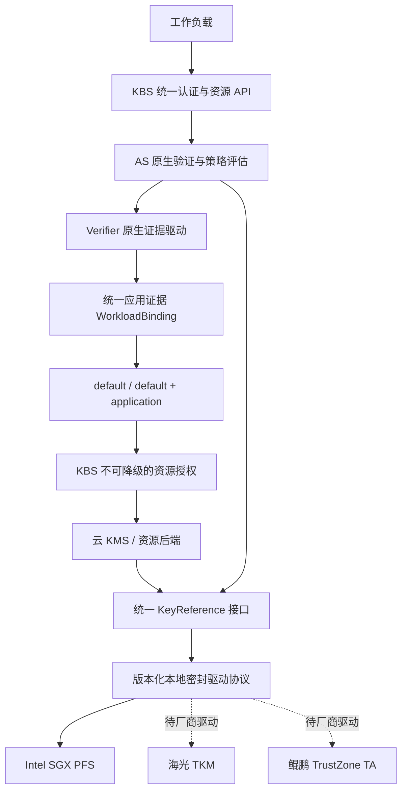

# 硬件透明的证明与长期凭据保护

业务层统一使用两种证明模式和密封凭据引用。硬件差异收敛在驱动层；KBS、AS、云 KMS 和 guest 的硬件可以不同。密钥保护设备与工作负载证明设备分别配置，不能从 CPU 厂商推断安全能力。



## 两个独立的扩展边界

| 边界 | 统一契约 | 原生驱动职责 |
| --- | --- | --- |
| 工作负载证明 | 既有 `Verifier`、`ApplicationEvidenceAdapter`、EAR | 验证签名、证书链、nonce/公钥绑定、启动绑定，输出可信度量 |
| 服务端长期凭据 | `KeyReference`、`ProviderRequest/Response` v1 | 将凭据密封到本机硬件信任根，并验证 key ID 与用途绑定 |

SGX、TKM、TrustZone 是长期凭据保护后端候选。它们不会自动赋予 guest TDX、CSV、CCA 或其他证明能力。TrustZone 凭据驱动与 CCA verifier 是不同接口。没有支持的驱动时应报错，禁止换用明文文件、模拟器或默认启动证明作为替代。

公共接口位于 `deps/platform-api`，不链接 SGX SDK。Intel 实现编译为单独的 `sgx-key-provider`。将来厂商交付 TKM/TrustZone 驱动后，仅部署该可执行文件并调整运维配置；KBS/AS 的凭据业务代码和外部 HTTP API 不增加厂商分支。

## 两种策略的闭环

| 选择器 | AS 策略 | 资源空间 | 最低放行条件 |
| --- | --- | --- | --- |
| 省略或 `default` | `default_cpu` | `default/<type>/<tag>` | 默认评估 affirming，平台可信向量符合要求 |
| `workload` | `default_cpu` + `application_cpu` | `workload/<type>/<tag>` | 两份评估均 affirming，并具备受批准的启动绑定与应用度量 |

`default` 和 `workload` 内置于 KBS，不再依赖 Helm 是否配置映射；保留旧的管理员自定义选择器接口。保留模式不能重映射，`application` 单独选择会被拒绝。资源路径由资源拥有者确定，客户端不能用选择器改变资源的要求。

KBS 在 JWT 验签之后、任何资源后端调用之前执行编译进程序的最低资源策略，再执行管理员可修改的策略。两者都必须通过。已有数据库里的宽松策略无法绕过最低要求。此行为会使以前放行 warning token 或使用其他仓库前缀的部署拒绝请求，需要在升级时迁移资源路径。

AS 仅在原生 verifier 验证成功后生成标准 `workload` claim，包含 profile、度量算法/摘要、参考值 ID、启动摘要等。客户端 runtime-data 中同名字段不会被提升为该可信 claim。应用策略按统一字段评估，不读取 TDX 寄存器路径；资源策略也不要求 TDX 专属字段。

当前应用适配器实现 TDX RTMR[3] + MRCONFIGID，继续兼容 RVPS 的 `application_rtmr_3` 和 `application_init_data`。其他平台需要提交经过原生验证且具有同等语义的应用度量适配器。仅有启动 measurement 的平台不能获得应用模式授权。默认模式继续使用各平台已有的原生验证和默认策略；有 verifier 不等于已经配置了可放行的策略及参考值。

批准的 Init-Data 必须约束真实执行的 Agent Policy、镜像依赖和可信测量服务。服务端代码无法替代 guest 的策略执行。真实应用验收必须使用非零、已批准的启动绑定，并验证批准应用成功、改应用失败、改启动组件失败、默认 token 访问应用资源失败。

## 长期凭据的信任边界

本版本提供硬件密封存储：磁盘只存密文，运行时通过本地私有 pipe 解密到 KBS/AS 的可信进程内存，供签名或调用外部 KMS 使用。支持任意非空、最多 64 KiB 的材料，可存访问密钥、AK/SK JSON、AAP client key、AS 签名私钥等。输入缓冲和协议秘密字段在释放时清零；下游 SDK 自己保留的凭据仍属于服务进程的信任范围。

这套接口不承诺“长期密钥永不离开硬件”。若后续要求这一能力，需单独扩展 `Sign`/`Mac`/`ExecuteCredentialOperation` 接口，让原生可信应用完成操作，并将相关 SDK 纳入可信执行环境；不能用当前 `Unseal` 冒充不可导出密钥。

当前接线包括 KBS Aliyun 凭据和 AS EAR 签名私钥。AK/SK 可通过公共密封接口保存，其他云后端的消费接线需按各自 SDK 补充。长期凭据不暴露为普通 guest 可请求的资源，也不通过旧 wrap HTTP 服务提供。

## 本地驱动协议 v1

每次调用启动一个受管理员控制的绝对路径可执行文件。stdin 输入一份 JSON，关闭 stdin 表示 EOF；stdout 返回一份 JSON。秘密仅走 pipe，不进入命令行或日志。环境默认清空，仅使用管理员显式列出的驱动环境。配置、驱动及其依赖必须由服务管理员保护，不能来自 Pod 请求。驱动描述是受信任组件的能力声明，不是远程证明。

| 请求 `operation` | 请求内容 | 响应 `result` |
| --- | --- | --- |
| `describe` | 无 | `description`：协议版本、驱动身份、hardware_sealing |
| `seal` | binding + base64 plaintext | `sealed`：base64 ciphertext |
| `unseal` | binding + base64 ciphertext | `unsealed`：base64 plaintext |

统一层检查版本、管理员预期的驱动身份、硬件密封能力、长度、30 秒超时和进程退出状态。错误响应不包含 SDK 原始错误或秘密。SDK 不存在、能力不匹配、认证失败均终止操作，不尝试软件降级。

驱动必须将 `{version, binding: {key_id, purpose}, plaintext}` 一起加密认证。外部文件头的 key ID/用途只用于预检查；解密后还必须校验内部绑定，防止不同服务凭据被调包。Intel 驱动以固定 basename `credential.protected` 调用 SGX PFS；临时文件只包含密文，明文通过 ECALL 传入。

## 配置与预置

参考配置示例（运维层替换驱动，业务逻辑不变）：

```json
{
  "provider": {
    "command": "/usr/local/libexec/sgx-key-provider",
    "arguments": [],
    "expected_provider": "intel-sgx-pfs",
    "environment": {
      "SGX_AAP_ENCLAVE": "/usr/local/lib/trustee/libenclave.signed.so"
    }
  },
  "sealed_path": "/var/lib/trustee/keys/aap-v1.json",
  "binding": {"key_id": "tenant-aap-v1", "purpose": "kbs-aliyun-credentials"}
}
```

先由管理员建立 0700 的持久目录，再执行：

```bash
cargo +1.95.0 build -p trustee-platform-api --bin trustee-key --locked --offline
cargo +1.95.0 build -p sgx-aap-wrap --bin sgx-key-provider --locked --offline
trustee-key describe --reference /etc/trustee/aap-reference.json
trustee-key seal --reference /etc/trustee/aap-reference.json < /secure/provision/aap.json
```

`aap.json` 的字段是 `client_key`、`password`、`cert_pem`。密封输出以 0600 原子落盘，并拒绝覆盖已有版本。完成预置后按组织的凭据管理流程移除明文材料。

KBS Aliyun 资源插件设置 `protected_credentials` 为上述引用对象，保留 `kms_instance_id`，并省略明文 `client_key`、`password`、`cert_pem`；混合两种来源会被拒绝。

AS 的 `attestation_token_broker.signer.protected_key` 使用同一引用结构，`purpose` 必须是 `as-token-signing`，密封内容是 P-256 PEM 私钥，省略 `key_path`。原有 `key_path` 配置保留兼容；同时配置会报错。

计划内硬件迁移/重新密封：

```bash
trustee-key rewrap --source /etc/trustee/old-reference.json \
  --destination /etc/trustee/new-reference.json
```

源和目标引用必须保留同一 key ID 和用途，目标使用新密文路径。迁移期间源硬件和两个驱动都必须可用。CPU 损坏后的灾难恢复需要预先建立独立备份或厂商恢复机制；单份绑定 CPU 的密文不能保证灾难恢复。旧 SGX PFS 文件另有导出/导入文件密钥的运维命令，不能将文件密钥与密文放在一起。

SGX 当前构建关闭 debug，并拒绝模拟模式。历史 debug enclave 的文件可能无法直接由 release enclave 打开；升级前必须在旧环境导出恢复材料或安排重新密封，禁止自动生成新密钥覆盖旧文件。

## 当前交付与验证边界

| 能力 | 当前状态 |
| --- | --- |
| 两模式选择、真实 RVPS 注册/查询、AS 策略聚合及 JWT 签名、KBS 资源判定 | 已接线，有合成 verifier 输出的闭环测试 |
| 统一凭据协议、身份/用途绑定、失败拒绝、原子预置和计划迁移 | 已实现；测试驱动只验证协议，不证明硬件安全 |
| Intel SGX PFS 驱动、生产 enclave 构建 | 已实现，硬件回归测试需单独运行 |
| TKM / TrustZone 原生驱动 | 缺 SDK/厂商接口，未实现；无默认替代 |
| 当前 guest 的可信应用正例 | 尚需真实 Init-Data、受限 Agent Policy 和实机验收 |
| 云 KMS 真实访问、多架构镜像发布 | 需凭据与目标环境验收；本次没有部署集群 |

测试：

```bash
cargo +1.95.0 test -p trustee-platform-api --locked --offline
cargo +1.95.0 test -p attestation-service --no-default-features --lib ear_token::broker::tests --locked --offline
cargo +1.95.0 test -p kbs --no-default-features --features coco-as-grpc --lib resource_policy::tests --locked --offline
cargo +1.95.0 test -p sgx-aap-wrap --lib key_provider::tests --locked --offline -- --ignored
```

最后一项只在 SGX 实机上执行。所有合成 claims 测试均不代表验证过真实 quote 签名。KBS 升级需与新 AS 一起发布；旧 AS 的 token 不包含标准应用绑定时，应用资源会按默认拒绝处理。仓库现有 `lab-20261108` 镜像不能视为本次源码的发布产物。
